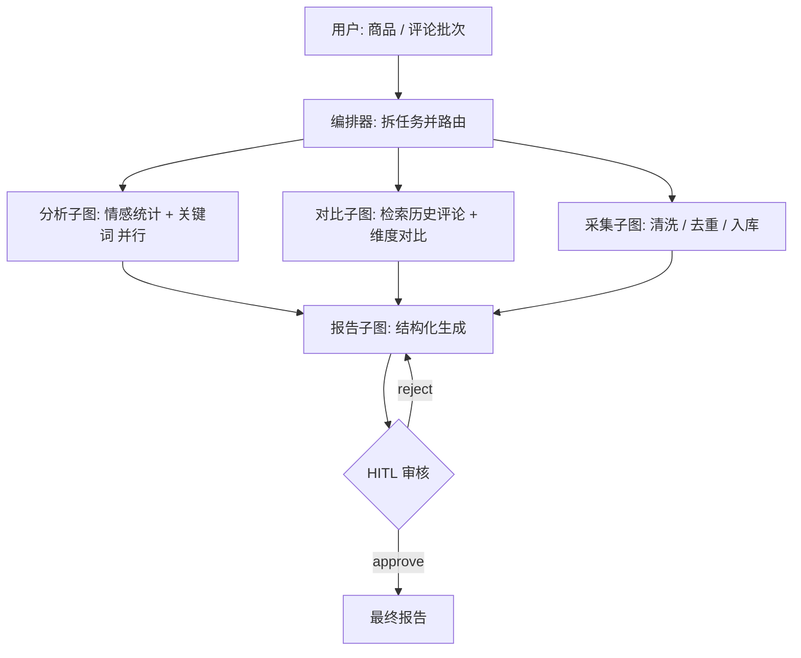

# ReviewLens

输入一批电商评论，自动跑完 清洗 → 情感分析 → 竞品维度对比 → 出洞察报告。报告必须人工点通过才输出。

## 为什么做这个

电商运营每天面对几百上千条评论，人工翻不完——通常只看最新几条，长尾里的重复投诉反而沉底，等发现时已经积累了几十条。

评论直接丢给通用大模型也不行：它会替你算数字、把一条差评说成趋势、把没提到的维度编得很像有依据。

所以做了这个：流程拆成固定几步，统计和对比由脚本算，模型只负责归纳和归因；报告在发出前必须人工审核，不让幻觉结论进周报。

## 架构



## 快速开始

环境：Windows + Python 3.12（实测 3.12.6）。右侧是这台上跑出来的真实输出。

```cmd
:: 1) 依赖
uv venv --python 3.12 .venv          :: 或 python -m venv .venv
.venv\Scripts\activate
pip install -r requirements.txt      :: 全量 freeze，112 个包

:: 2) 配置：在项目根建 .env（仓库不含 .env，也不含 .env.example）
LLM_BASE_URL=https://api.deepseek.com/v1
LLM_MODEL=deepseek-flash
LLM_API_KEY=***
CHROMA_PATH=./data/chroma

:: 3) 下载本地 embedding 模型（94.8 MB，二进制不入库）
mkdir models\bge-small-zh-v1.5 && cd models\bge-small-zh-v1.5
curl -L -o model.onnx            https://hf-mirror.com/Xenova/bge-small-zh-v1.5/resolve/main/onnx/model.onnx
curl -L -o tokenizer.json        https://hf-mirror.com/Xenova/bge-small-zh-v1.5/resolve/main/tokenizer.json
curl -L -o tokenizer_config.json https://hf-mirror.com/Xenova/bge-small-zh-v1.5/resolve/main/tokenizer_config.json
curl -L -o config.json           https://hf-mirror.com/Xenova/bge-small-zh-v1.5/resolve/main/config.json
cd ..\..

:: 4) 建索引 + 检索评测
python scripts\build_index.py        :: {"indexed": 190, "skipped": 20, "count": 190}  ~2.2s
python scripts\check_retrieval.py    :: hit@1 = 6/6   hit@3 = 6/6

:: 5) 起服务
python -m uvicorn app.main:app --port 8000
```

打开 **http://127.0.0.1:8000/docs**，选 `POST /chat`、Try it out，发
`{"message": "物流方面用户在抱怨什么？"}` —— 返回的 `reply` 里每一句都能在
`data/reviews_raw.jsonl` 里找到出处。再发 `{"message": "保修几年？"}`，
库里没有保修信息，正确行为是回答"评论里没有提到保修几年"（这条是 RAG 的负向验收）。

| 已知坑 | 处置 |
|---|---|
| `LLM_BASE_URL` 和 `LLM_MODEL` **必须成对更换** | 中转站的 id 是 `DeepSeek-V4.1-Flash-1017`，官方只有 `deepseek-flash` / `deepseek-v4-pro`；只改一个会 400 `model not found` |
| PowerShell 里 `curl` 是 `Invoke-WebRequest` 别名 | 用 `curl.exe`，或直接在 `/docs` 网页里试 |
| 请求 LLM 报 `ConnectionError` | 十有八九是 shell 里残留了 `HTTP_PROXY=127.0.0.1:7897` 而代理客户端没开。cmd 里 `set HTTP_PROXY=` 清掉再试；`set HTTPS_PROXY` 看有没有值就是这一步 |
| `model.onnx` 应为 **94,851,877 字节** | 小于这个数就是下载中断，删掉重下 |

## 进度

- [x] D1 环境验证 + 仓库骨架 + 210 条评论数据（含金标注）
- [x] D2 单 Agent 最小图 + `/chat`
- [x] D3 RAG 检索闭环（向量检索 + 离线评测；混合召回待做）
- [ ] D4 三个工具 + ToolNode
- [ ] D5 编排器 + 子图并行
- [ ] D6 SQLite 检查点 + HITL 中断恢复
- [ ] D7 SSE 流式 + 单页前端
- [ ] D8 Docker 部署
- [ ] D9 评估 + 演示视频 + README 定稿

<!-- 素材区：D9 整理技术难点时从这里搬，勿删 -->

<!--
2026-11-11 通道探针（scripts/probe_llm_capabilities.py）
- sensenova deepseek-v4-flash：chat / tool_call / structured 三项全部 429
- tokenjuice DeepSeek-V4.1-Flash-1017：chat OK，tool_call 0.9s，structured 1.2s
- 结论：同一模型换通道能力不同，按 (base_url, model) 组合验证，不能按模型名判断

2026-11-11 embedding（scripts/probe_local_embedding.py）
- chromadb 默认 all-MiniLM（英文）：模型源 36 KB/s，79MB 下不完
- BAAI/bge-small-zh-v1.5 ONNX：hf-mirror 21.4 MB/s，512 维，4 条 11ms
- 语义标定：sim(物流太慢, 快递很慢)=0.792 > sim(物流太慢, 电池不耐用)=0.544 > sim(物流太慢, 音质很好)=0.415

2026-11-11 数据
- 210 条合成评论（6 个 SKU / 2 品类），30 条人为注入脏数据，金标注在 data/reviews_gold.jsonl

2026-11-12 通道切换到 DeepSeek 官方（.env 层切换，代码零改动——配置参数化的回报）
- 官方模型 id 只有 deepseek-flash / deepseek-v4-pro（没有 deepseek-chat）
- deepseek-flash 默认思考模式：with_structured_output 必须 extra_body={"thinking":{"type":"disabled"}}，
  且必须构造时传（bind 不转发）；bind_tools 在思考模式下正常
- 探针三项全绿：chat 1.4s / tool_call 1.6s / structured 1.9s（关思考）；直连 0.18s，无需代理
- 排坑：shell 残留 HTTPS_PROXY=127.0.0.1:7897 而 Clash 未开 → ConnectionError；网络报错先查代理变量
- D2：最小图 START→agent→END 跑通；/health 200；POST /chat 返回 reply；空 body 自动 422

2026-11-12 D3 检索实测（scripts/build_index.py + scripts/check_retrieval.py）
- 210 条入库 2.2s：indexed 200 / skipped 10（空文本与超短噪声在入库前拦掉）
  ↑ 11-17 修正：加索引侧文本去重后为 indexed 190 / skipped 20，见下方「数据与口径修正」
- 6 组「查询→期望维度」离线评测：hit@1 6/6、hit@3 6/6，sim 区间 0.59~0.82
  ⚠ 查询词与维度词表同源，这组数字只证明"通路正确"，不等于"效果好"；D9 要造非同源说法集
- 稀有 token 漏召回（hybrid 立项依据）：HX3216 / AirPods 各仅 1 条含该词且确已入库，
  纯向量 top3 均未命中，且两个无关查询返回完全相同的相似度序列 [0.501, 0.491, 0.490]；
  关键字精确匹配 100% 命中 → 结论：BM25 + 向量双路 + RRF
- 精确标识（型号 / SKU / 订单号）不该走向量检索：查「TWS-X1」返回 P3，
  因为型号串在评论文本中出现 0 次（存在 metadata 里）→ 正解是 where={"product_id": ...} 过滤
- 防幻觉负例：问「保修几年」（库内无保修维度）→ 「评论里没有提到保修年限。」
- 正向溯源：回答的 5 处事实断言全部可在检索原文逐字命中；中性评论被模型自行排除出"抱怨"
- chromadb 1.5.9 坑：query() 走 embed_query(input=)，只实现 __call__ 会写入正常、查询 AttributeError

2026-11-17 数据与评测口径修正（D4 开工前）
- 缺陷①：`gen_reviews.py` 用 `rating = 6 - rating` 造"评分矛盾"，对 rating=3 是空操作（3→3），
  造出 gold 标脏但评分/文本零差异的样本 → 改判 2 条为 clean（gold dirty 30 → 28）；
  脚本侧改为按 gold 情感指定反向评分档 FLIP={pos:(1,2), neg:(4,5), neu:(1,5)}，保证注入必然可检
- 缺陷②：dup 副本进了向量库（曾有 10 条重复文本白占 topK）→ `index_reviews` 加 seen_texts
  按文本去重，现索引内重复组 0；注意 `seen_texts.add()` 必须在所有 continue 之后（先决定留，再登记）
- 缺陷③：`inject_noise` 之后有 `rnd.shuffle(rows)`，重复组内"哪条算副本"无定义 ⇒
  评测重复类必须按组判（每组恰好留 1 条），不能按 id 与 gold 的 -dup 后缀对齐
- clean_data 规则首次体检：格式类召回 14/14=1.00 | 精确率 14/16=0.875 | 重复类组级 10/10 |
  评分矛盾 0/4（规则不可达）。误杀 2 条根因：`[A-Za-z]{4,}` 把合法提及 AirPods / iPad 的评论
  判成中英混 ⇒ 需品牌竞品白名单兜底。另：手写情感词典 vs gold 仅 0.300（88 条 pos 估成 neu，
  阈值 >=2 命中词对 20-50 字短评过严）⇒ 语义矛盾不放进规则清洗，评测四个数分开报
- 撤回的错误结论：①"规则召回 0.467"（口径混了数据缺陷与工具能力）②"7 条孤儿 dup"（实测 0）
  ③"3 条零差异样本"（实为 2 条，第 3 条是被截断文本误导）④"改完数据天花板 1.0"（混淆标注自洽与可检出）
- 重跑后检索结论未变：hit@1 6/6、hit@3 6/6、稀有 token 仍漏召回 [0.50, 0.49, 0.49]
-->

