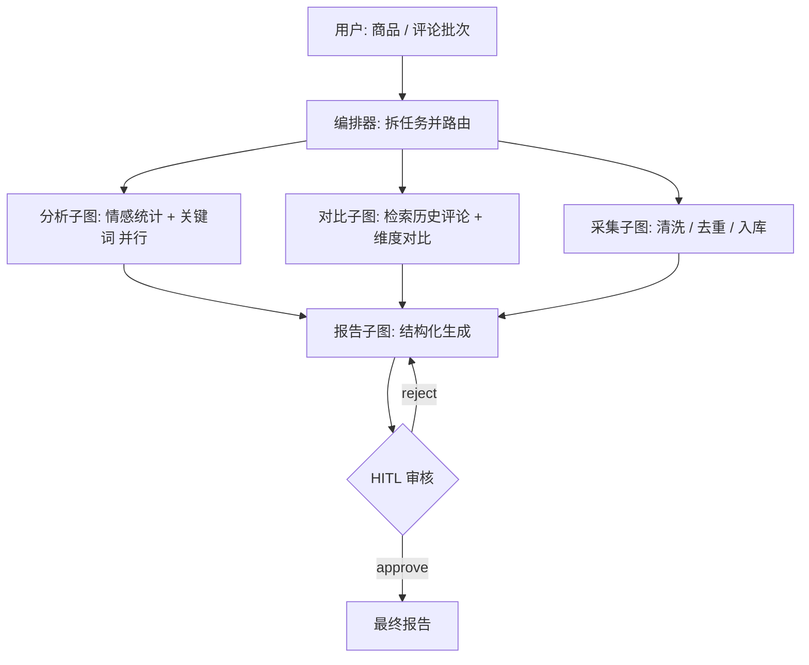

# ReviewLens

输入一批电商评论，自动跑完 清洗 → 情感分析 → 竞品维度对比 → 出洞察报告。报告必须人工点通过才输出。

## 为什么做这个

电商运营每天面对几百上千条评论，人工翻不完——通常只看最新几条，长尾里的重复投诉反而沉底，等发现时已经积累了几十条。

评论直接丢给通用大模型也不行：它会替你算数字、把一条差评说成趋势、把没提到的维度编得很像有依据。

所以做了这个：流程拆成固定几步，统计和对比由脚本算，模型只负责归纳和归因；报告在发出前必须人工审核，不让幻觉结论进周报。

## 架构



## 快速开始

环境：Windows + Python 3.12（实测 3.12.6）。右侧是这台上跑出来的真实输出。

```cmd
:: 1) 依赖
uv venv --python 3.12 .venv          :: 或 python -m venv .venv
.venv\Scripts\activate
pip install -r requirements.txt      :: 全量 freeze，112 个包

:: 2) 配置：在项目根建 .env（仓库不含 .env，也不含 .env.example）
LLM_BASE_URL=https://api.deepseek.com/v1
LLM_MODEL=deepseek-flash
LLM_API_KEY=***
CHROMA_PATH=./data/chroma

:: 3) 下载本地 embedding 模型（94.8 MB，二进制不入库）
mkdir models\bge-small-zh-v1.5 && cd models\bge-small-zh-v1.5
curl -L -o model.onnx            https://hf-mirror.com/Xenova/bge-small-zh-v1.5/resolve/main/onnx/model.onnx
curl -L -o tokenizer.json        https://hf-mirror.com/Xenova/bge-small-zh-v1.5/resolve/main/tokenizer.json
curl -L -o tokenizer_config.json https://hf-mirror.com/Xenova/bge-small-zh-v1.5/resolve/main/tokenizer_config.json
curl -L -o config.json           https://hf-mirror.com/Xenova/bge-small-zh-v1.5/resolve/main/config.json
cd ..\..

:: 4) 建索引 + 检索评测
python scripts\build_index.py        :: {"indexed": 186, "skipped": 24, "count": 186}  ~2s
python scripts\check_retrieval.py    :: hit@1 = 6/6   hit@3 = 6/6

:: 5) 起服务
python -m uvicorn app.main:app --port 8000
```

打开 **http://127.0.0.1:8000/docs**，选 `POST /chat`、Try it out，发
`{"message": "物流方面用户在抱怨什么？"}` —— 返回的 `reply` 里每一句都能在
`data/reviews_raw.jsonl` 里找到出处。再发 `{"message": "保修几年？"}`，
库里没有保修信息，正确行为是回答"评论里没有提到保修几年"（这条是 RAG 的负向验收）。

| 已知坑 | 处置 |
|---|---|
| `LLM_BASE_URL` 和 `LLM_MODEL` **必须成对更换** | 中转站的 id 是 `DeepSeek-V4.1-Flash-1017`，官方只有 `deepseek-flash` / `deepseek-v4-pro`；只改一个会 400 `model not found` |
| PowerShell 里 `curl` 是 `Invoke-WebRequest` 别名 | 用 `curl.exe`，或直接在 `/docs` 网页里试 |
| 请求 LLM 报 `ConnectionError` | 十有八九是 shell 里残留了 `HTTP_PROXY=127.0.0.1:7897` 而代理客户端没开。cmd 里 `set HTTP_PROXY=` 清掉再试；`set HTTPS_PROXY` 看有没有值就是这一步 |
| `model.onnx` 应为 **94,851,877 字节** | 小于这个数就是下载中断，删掉重下 |

## 进度

- [x] D1 环境验证 + 仓库骨架 + 210 条评论数据（含金标注）
- [x] D2 单 Agent 最小图 + `/chat`
- [x] D3 RAG 检索闭环（向量检索 + 离线评测；混合召回待做）
- [x] D4 三个工具 + ToolNode + 工具轮次成本闸
- [ ] D5 编排器 + 子图并行
- [ ] D6 SQLite 检查点 + HITL 中断恢复
- [ ] D7 SSE 流式 + 单页前端
- [ ] D8 Docker 部署
- [ ] D9 评估 + 演示视频 + README 定稿

<!-- 素材区：D9 整理技术难点时从这里搬，勿删 -->

<!--
2026-11-11 通道探针（scripts/probe_llm_capabilities.py）
- sensenova deepseek-v4-flash：chat / tool_call / structured 三项全部 429
- tokenjuice DeepSeek-V4.1-Flash-1017：chat OK，tool_call 0.9s，structured 1.2s
- 结论：同一模型换通道能力不同，按 (base_url, model) 组合验证，不能按模型名判断

2026-11-11 embedding（scripts/probe_local_embedding.py）
- chromadb 默认 all-MiniLM（英文）：模型源 36 KB/s，79MB 下不完
- BAAI/bge-small-zh-v1.5 ONNX：hf-mirror 21.4 MB/s，512 维，4 条 11ms
- 语义标定：sim(物流太慢, 快递很慢)=0.792 > sim(物流太慢, 电池不耐用)=0.544 > sim(物流太慢, 音质很好)=0.415

2026-11-11 数据
- 210 条合成评论（6 个 SKU / 2 品类），30 条人为注入脏数据，金标注在 data/reviews_gold.jsonl

2026-11-12 通道切换到 DeepSeek 官方（.env 层切换，代码零改动——配置参数化的回报）
- 官方模型 id 只有 deepseek-flash / deepseek-v4-pro（没有 deepseek-chat）
- deepseek-flash 默认思考模式：with_structured_output 必须 extra_body={"thinking":{"type":"disabled"}}，
  且必须构造时传（bind 不转发）；bind_tools 在思考模式下正常
- 探针三项全绿：chat 1.4s / tool_call 1.6s / structured 1.9s（关思考）；直连 0.18s，无需代理
- 排坑：shell 残留 HTTPS_PROXY=127.0.0.1:7897 而 Clash 未开 → ConnectionError；网络报错先查代理变量
- D2：最小图 START→agent→END 跑通；/health 200；POST /chat 返回 reply；空 body 自动 422

2026-11-12 D3 检索实测（scripts/build_index.py + scripts/check_retrieval.py）
- 210 条入库 2.2s：indexed 200 / skipped 10（空文本与超短噪声在入库前拦掉）
  ↑ 11-17 修正：加索引侧文本去重后为 indexed 190 / skipped 20，见下方「数据与口径修正」
- 6 组「查询→期望维度」离线评测：hit@1 6/6、hit@3 6/6，sim 区间 0.59~0.82
  ⚠ 查询词与维度词表同源，这组数字只证明"通路正确"，不等于"效果好"；D9 要造非同源说法集
- 稀有 token 漏召回（hybrid 立项依据）：HX3216 / AirPods 各仅 1 条含该词且确已入库，
  纯向量 top3 均未命中，且两个无关查询返回完全相同的相似度序列 [0.501, 0.491, 0.490]；
  关键字精确匹配 100% 命中 → 结论：BM25 + 向量双路 + RRF
- 精确标识（型号 / SKU / 订单号）不该走向量检索：查「TWS-X1」返回 P3，
  因为型号串在评论文本中出现 0 次（存在 metadata 里）→ 正解是 where={"product_id": ...} 过滤
- 防幻觉负例：问「保修几年」（库内无保修维度）→ 「评论里没有提到保修年限。」
- 正向溯源：回答的 5 处事实断言全部可在检索原文逐字命中；中性评论被模型自行排除出"抱怨"
- chromadb 1.5.9 坑：query() 走 embed_query(input=)，只实现 __call__ 会写入正常、查询 AttributeError

2026-11-17 数据与评测口径修正（D4 开工前）
- 缺陷①：`gen_reviews.py` 用 `rating = 6 - rating` 造"评分矛盾"，对 rating=3 是空操作（3→3），
  造出 gold 标脏但评分/文本零差异的样本 → 改判 2 条为 clean（gold dirty 30 → 28）；
  脚本侧改为按 gold 情感指定反向评分档 FLIP={pos:(1,2), neg:(4,5), neu:(1,5)}，保证注入必然可检
- 缺陷②：dup 副本进了向量库（曾有 10 条重复文本白占 topK）→ `index_reviews` 加 seen_texts
  按文本去重，现索引内重复组 0；注意 `seen_texts.add()` 必须在所有 continue 之后（先决定留，再登记）
- 缺陷③：`inject_noise` 之后有 `rnd.shuffle(rows)`，重复组内"哪条算副本"无定义 ⇒
  评测重复类必须按组判（每组恰好留 1 条），不能按 id 与 gold 的 -dup 后缀对齐
- clean_data 规则首次体检：格式类召回 14/14=1.00 | 精确率 14/16=0.875 | 重复类组级 10/10 |
  评分矛盾 0/4（规则不可达）。误杀 2 条根因：`[A-Za-z]{4,}` 把合法提及 AirPods / iPad 的评论
  判成中英混 ⇒ 需品牌竞品白名单兜底。另：手写情感词典 vs gold 仅 0.300（88 条 pos 估成 neu，
  阈值 >=2 命中词对 20-50 字短评过严）⇒ 语义矛盾不放进规则清洗，评测四个数分开报
- 撤回的错误结论：①"规则召回 0.467"（口径混了数据缺陷与工具能力）②"7 条孤儿 dup"（实测 0）
  ③"3 条零差异样本"（实为 2 条，第 3 条是被截断文本误导）④"改完数据天花板 1.0"（混淆标注自洽与可检出）
- 重跑后检索结论未变：hit@1 6/6、hit@3 6/6、稀有 token 仍漏召回 [0.50, 0.49, 0.49]

2026-11-17 D4 完成（三工具 + ToolNode + 成本闸）
- 三工具参数统一为 product_ids；clean_data 改多商品后全库回归不变（210→kept 186，
  per_sku 六个 kept 相加 = 31+30+34+32+31+28 = 186，可加性自检通过）
- 例句改为「差评优先 + 跨话题不重复」：8 个话题给出 8 条不同例句（评分 1,1,2,2,3,4,3,4）；
  改完立刻暴露词典误命中的真面目——「充电仓有划痕」被算进续航、「人声很干净」被算进清洁力，
  这就是 precision 0.779 里那 22% 的具体长相 ⇒ 话题结论必须模型复核，词典不能单独定案
- 词典与成绩单一起放 data/dimensions.json（topics + eval{precision,recall,against,measured_at}）；
  工具把 eval 原样抄进返回值 ⇒ 模型回答里自己说出「覆盖率约 53%，条数是下限」
- ⑤ 验收：模型完全自主填参数 product_ids=['TWS-M2','TWS-X1']，且一轮并行请求 3 个工具
  （消息序列 human→ai→tool×3→ai 共 6 条），结论正确；top_n/example_limit 也是它自己调的
- ⚠️ 第一版 ReAct 在 recursion_limit=8 下抛 GraphRecursionError。根因：limit 数的是超级步不是工具轮次
  （1 轮工具往返 = tools + agent = 2 步，8 只够约 3 轮）⇒ 同一条问题有时过有时崩，属最危险的不稳定
- 修法：state 加 tool_rounds，call_model 只在真请求工具时 +1，route_after_agent 硬闸 MAX_TOOL_ROUNDS=2；
  单元测试（不调 LLM、确定性）：rounds=0/1→tools，rounds=2/5→__end__，无 tool_calls→__end__
- 模型曾把品牌名当商品 ID 传（['声浪','皓齿']）→ unknown_product_ids + available_product_ids 让它自纠成功，
  回答里如实说「工具里没有这两个商品，没法做话题统计」；再在 system 里给出 KNOWN_IDS 清单后，改为传 6 个真 ID
- 负例升级：问保修年限 → 「没有提到保修年限，只有一条相关线索」，逐句溯源 OB-B2-3913-028
  原文确有「刷柄进水不震…最后说不在保修范围」⇒ 仍是零编造，且比 D3 的纯拒答信息量更高
- 成本实测：keyword_extract top_n=4 输出 3678 字符、top_n=8 6020；clean_data 8 样本 1428 字符
- API 细节：tools_condition 返回的是字符串 "__end__"（不是 END 对象），映射表键必须写 "__end__"；
  换成自定义 route_after_agent 后可省 path_map（返回值直接当节点名）
- D5 伏笔（已亲眼见到）：② 里三个 ToolMessage 并行写 messages 没冲突，全靠 add_messages reducer；
  D5 两个子图并行写同一个标量字段没配 reducer 就会 InvalidUpdateError
  （实测最小图复现原文：At key 'sentiment': Can receive only one value per step. Use an Annotated key…；
   配 Annotated[dict, merge] 后两个分支的值都在）

2026-11-18 D5-① 清洗口径统一（app/rules.py 上线）
- 动因：三份规则（clean_data / sentiment_stats / keyword_extract 各抄一遍）+ 索引侧还有第四份
  （rag.py 自己的 JUNK 元组，连 "  " 都没有）⇒ "两份真相"已经漂移到字段级别
- 新件：rules.py = junk_reason(纯函数，单条可判) + dedupe(有状态，跨条) + clean_rows(流水线)
  拆三个函数而不是一个：输入不同、状态不同，合并就会逼 clean_data 改成批处理且没法单条问"脏不脏"
- clean_rows 内部顺序 = 先格式规则、后去重（保序的原因：D4 记录的剔除分布 {empty10,has_link1,mixed_lang3,duplicate10}
  可以原样复现；反过来会把"空文本的副本"记成 duplicate，README 数字全部要重测）
- 跨模块等式（新验收标准）：索引 indexed == 工具 kept == 186；索引 by_reason == 工具 removed 逐字一致
- 顺序无关性（新能力）：一次查两个 SKU = 60、分开查相加 = 60、全库里这两个 = 60，三者一致
  ← D4 版本按 target 顺序去重，将来出现跨商品重复文本时结果会随请求范围漂移
- 代价实测：hit@1 6/6、hit@3 6/6 不变 ⇒ 我原先设想的"入库宽、分析严"被自己的数据否决，直接统一
- ⚠️ 数字更正：口径统一后索引 186（原 190）、sentiment TWS-M2 n=32 avg=3.47（原 36/3.42）、
  keyword_extract TWS-M2 续航 n=8/3.38（原 9/3.22）；OB-C9 话题数 8→6
  被排除那条是带英文尾缀的中英混样本且评分偏高 ⇒ 一条活教材：脏数据同时影响条数和均值
- ⚠️ 稀有 token 证据降级：HX3216 仍稳定漏召回（两个查询 sim 序列依旧完全相同 [0.501,0.490,0.488]），
  但 AirPods 索引重建后已进 top3（sim=0.488）⇒ README/面试话术改为"仅 HX3216 稳定漏"，不能再说两个都漏
- 图级回归（口径变了必须重跑）：正向 4 条消息、结论引用工具数据；负向"没有提到具体保修年限"
  并准确引用 OB-B2-3913-028 原文"最后说不在保修范围"，仍零编造
- 官方现成件 langgraph-supervisor / langgraph-swarm 均未安装，决定不装：3 个工作者自写路由约 30 行，
  且"编排器怎么决定调用哪个工作者"必须能答自己的实现（方案第九节"只会说用了 LangGraph"的反面）
-->

