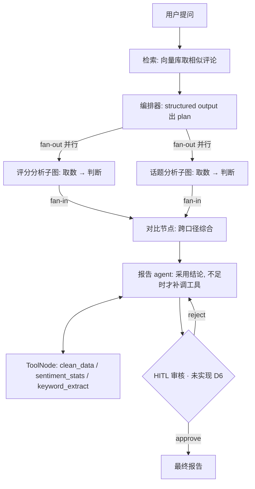

# ReviewLens

输入一批电商评论，自动跑完 清洗 → 情感分析 → 竞品维度对比 → 出洞察报告。报告必须人工点通过才输出。

## 为什么做这个

电商运营每天面对几百上千条评论，人工翻不完——通常只看最新几条，长尾里的重复投诉反而沉底，等发现时已经积累了几十条。

评论直接丢给通用大模型也不行：它会替你算数字、把一条差评说成趋势、把没提到的维度编得很像有依据。

所以做了这个：流程拆成固定几步，统计和对比由脚本算，模型只负责归纳和归因；报告在发出前必须人工审核，不让幻觉结论进周报。

## 架构



> 与最初设计稿的两处差异：**清洗不是独立子图**，是 `clean_data` 工具（D4 落地时就定了）；
> **HITL 还没做**（D6）。图里保留未实现节点是为了标出它在链路里的位置。

## 快速开始

环境：Windows + Python 3.12（实测 3.12.6）。右侧是这台上跑出来的真实输出。

```cmd
:: 1) 依赖
uv venv --python 3.12 .venv          :: 或 python -m venv .venv
.venv\Scripts\activate
pip install -r requirements.txt      :: 全量 freeze，112 个包

:: 2) 配置：在项目根建 .env（仓库不含 .env，也不含 .env.example）
LLM_BASE_URL=https://api.deepseek.com/v1
LLM_MODEL=deepseek-flash
LLM_API_KEY=***
CHROMA_PATH=./data/chroma

:: 3) 下载本地 embedding 模型（94.8 MB，二进制不入库）
mkdir models\bge-small-zh-v1.5 && cd models\bge-small-zh-v1.5
curl -L -o model.onnx            https://hf-mirror.com/Xenova/bge-small-zh-v1.5/resolve/main/onnx/model.onnx
curl -L -o tokenizer.json        https://hf-mirror.com/Xenova/bge-small-zh-v1.5/resolve/main/tokenizer.json
curl -L -o tokenizer_config.json https://hf-mirror.com/Xenova/bge-small-zh-v1.5/resolve/main/tokenizer_config.json
curl -L -o config.json           https://hf-mirror.com/Xenova/bge-small-zh-v1.5/resolve/main/config.json
cd ..\..

:: 4) 建索引 + 检索评测
python scripts\build_index.py        :: {"indexed": 186, "skipped": 24, "count": 186}  ~2s
python scripts\check_retrieval.py    :: hit@1 = 6/6   hit@3 = 6/6

:: 5) 起服务
python -m uvicorn app.main:app --port 8000
```

打开 **http://127.0.0.1:8000/docs**，选 `POST /chat`、Try it out，发
`{"message": "物流方面用户在抱怨什么？"}`。

**返回的不是成品**，而是 `status: "awaiting_review"` + 一份待审批草稿（`review.draft`），
每一句都能在 `data/reviews_raw.jsonl` 里找到出处。报告要再走一步才算发布：

```json
POST /review  {"thread_id": "<上一步返回的单号>", "decision": "approve"}
→ status: "published", report: "……"
```

实测 `report` 与当时审的那份草稿**逐字相同**——审的就是发的。中途刷新页面可以先查
`GET /review/{单号}`，它不碰模型、不花钱，只告诉你这单还卡在哪个节点、草稿是什么。

不想翻 `/docs` 就直接开首页 **http://127.0.0.1:8000/** —— 前端是 `web/index.html` **一个文件**
（324 行，无框架无构建），由 `app.mount` 挂在 `/`，同源所以不需要开 CORS。输入问题就能看到
6 行中文进度、逐字打字机、审批面板和两个按钮。它走的是一条 SSE，事件名就是协议：

```cmd
:: 浏览器原生 EventSource 只能发 GET，所以参数全在问号后面（中文要编码）
curl -N "http://127.0.0.1:8000/chat/stream?message=%E7%89%A9%E6%B5%81%E6%80%8E%E4%B9%88%E6%A0%B7"
curl -N "http://127.0.0.1:8000/review/stream?thread_id=<上一步的单号>&decision=reject&note=%E8%A1%A5%E8%AF%81%E6%8D%AE"

:: 事件序列（实测一次提问）
:: run.started{thread_id} → node.progress ×6 → tool.progress ×1
::   → assistant.delta ×182 → review.required{draft,round:1/2}
:: 再点「通过」：run.started → node.progress ×1 → run.completed{published}   ← 0 段 delta、0.51s
```

真浏览器端到端实测（Chrome + CDP 真点按钮）：**提问 4.61s 出审批、拒绝 3.58s 实时重写 573 段、
通过 0.51s 发布**；整场 `EventSource` 实例数恰好 3（一次提问/一次拒绝/一次通过），页面 JS 异常 0。

`thread_id` 不传就由服务端生成并随响应返回，**多轮对话必须把它带回来**，
否则每次都是新会话（实测：共用默认单号时，第二个问题会背上第一个问题的 4 条历史，
而且审批轮次也串了——A 连拒两次会让 B 永远拿不到报告）。

再发 `{"message": "保修几年？"}`，库里没有保修信息，正确行为是回答"评论里没有提到保修几年"
（这条是 RAG 的负向验收）。连拒两次则返回 `status: "not_published"`：被明确拒过的稿不发布。

| 已知坑 | 处置 |
|---|---|
| `LLM_BASE_URL` 和 `LLM_MODEL` **必须成对更换** | 中转站的 id 是 `DeepSeek-V4.1-Flash-1017`，官方只有 `deepseek-flash` / `deepseek-v4-pro`；只改一个会 400 `model not found` |
| PowerShell 里 `curl` 是 `Invoke-WebRequest` 别名 | 用 `curl.exe`，或直接在 `/docs` 网页里试 |
| 请求 LLM 报 `ConnectionError` | 十有八九是 shell 里残留了 `HTTP_PROXY=127.0.0.1:7897` 而代理客户端没开。cmd 里 `set HTTP_PROXY=` 清掉再试；`set HTTPS_PROXY` 看有没有值就是这一步 |
| `model.onnx` 应为 **94,851,877 字节** | 小于这个数就是下载中断，删掉重下 |

## Docker 部署（D8）

一条命令起同一个服务，端口 **8800**（避开本机手起的 8000/8799）：

```cmd
:: 前置仍是「快速开始」的 1)~3)：clone 代码、手建 .env、下载 models/ 权重
::（权重既不进 git 也不进镜像，compose 是挂载进去的，所以这三步省不掉）
docker compose up -d --build

:: 构建上下文：87.75kB（仓库根目录实测 464 MB，.venv 一个目录占 364 MB）
:: 镜像 925 MB：代码三层合计只有 172 KB，剩下全是 112 个依赖
:: 容器状态（HEALTHCHECK 是真通过了一次，不是只写在 Dockerfile 里）：
::   reviewlens-web-1   Up 16 seconds (healthy)   0.0.0.0:8800->8000/tcp
```

打开 **http://127.0.0.1:8800/** 就是同一个前端，返回的字节流与磁盘上的 `web/index.html`
**sha256 逐字节相同**（`76430c53…`）。跑的是同一份代码，协议、事件、审批语义和上面完全一致。

三个决定，以及各自的实测依据：

| 决定 | 依据 |
|---|---|
| 基础镜像用 `python:3.12.6-slim-bookworm`，**不用 alpine** | 本机实测 alpine 72 MB / slim 189 MB，但 alpine 是 **musl**（`/lib/ld-musl-x86_64.so.1`，`platform.libc_ver()` 返回空），而 `onnxruntime`/`chromadb` 只发布 glibc 编译的 `.so`。为省 117 MB 换来依赖装不上，不划算 |
| slim 里必须 `apt-get install libgomp1` | 不装则 `import onnxruntime` 当场 `libgomp.so.1: cannot open shared object file`；容器内实测 `ORT 1.31.1` 通过 |
| 权重 91 MB 与 `data/` 走挂载、`.env` 走 `env_file` | 镜像内扫描 `/app` 只有 `app data requirements.txt scripts web`，**没有 `.env` / `.venv` / `models` / `.git`**（密钥进层等于 `docker history` 可翻） |

挂载方向也实测过——这条是"Docker 会不会把数据关在容器里"的判据：

```cmd
:: 容器内读宿主的卷：集合 reviews count = 186（与本机 build_index 结果一致）
:: 检查点：548 行 / 39 个会话单号，全是 D6~D7 期间产生的
:: 跑完一次真提问后 docker compose restart：同一个单号仍查得到，report 384 字
:: 宿主 data/checkpoints.db：5,488,640 → 5,779,456 字节   ← 容器写的就是宿主文件
:: models 挂成 :ro，容器内 touch 报 Read-only file system
```

⚠️ 两件**没做**的事，别当成已交付：**不推任何 registry**（这镜像离开外部 LLM key 就跑不起来，推上去没意义）；**仍然没有鉴权**——`/review` 与 `GET /review/{单号}` 无登录、`thread_id` 就是能力凭证，而 `docker ps` 实测这个端口监听在 **`0.0.0.0`**，也就是局域网里别人能访问。只给自己用就把它改成 `127.0.0.1:8800:8000`；要对外演示必须先加登录或一次性 token。

## 进度

- [x] D1 环境验证 + 仓库骨架 + 210 条评论数据（含金标注）
- [x] D2 单 Agent 最小图 + `/chat`
- [x] D3 RAG 检索闭环（向量检索 + 离线评测；混合召回待做）
- [x] D4 三个工具 + ToolNode + 工具轮次成本闸
- [x] D5 编排器（structured output + 枚举白名单）+ 评分/话题子图并行 + fan-in 对比；结论已回灌报告节点
- [x] D6 SQLite 检查点 + HITL 审批中断（跨进程恢复实测；`/review` 单号协议）
- [x] D7 SSE 流式（v2 协议 + 双层事件过滤 + 心跳 + 断连取消）+ 单页前端（真浏览器端到端实测）
- [x] D8 Docker 部署（Dockerfile + .dockerignore + compose；上下文 464MB→87.75kB，镜像 925MB，healthy 实测，SSE 过 NAT 未缓冲，重启后单号仍可查）
- [ ] D9 评估 + 演示视频 + README 定稿

<!-- 素材区：D9 整理技术难点时从这里搬，勿删 -->

<!--
2026-11-11 通道探针（scripts/probe_llm_capabilities.py）
- sensenova deepseek-v4-flash：chat / tool_call / structured 三项全部 429
- tokenjuice DeepSeek-V4.1-Flash-1017：chat OK，tool_call 0.9s，structured 1.2s
- 结论：同一模型换通道能力不同，按 (base_url, model) 组合验证，不能按模型名判断

2026-11-11 embedding（scripts/probe_local_embedding.py）
- chromadb 默认 all-MiniLM（英文）：模型源 36 KB/s，79MB 下不完
- BAAI/bge-small-zh-v1.5 ONNX：hf-mirror 21.4 MB/s，512 维，4 条 11ms
- 语义标定：sim(物流太慢, 快递很慢)=0.792 > sim(物流太慢, 电池不耐用)=0.544 > sim(物流太慢, 音质很好)=0.415

2026-11-11 数据
- 210 条合成评论（6 个 SKU / 2 品类），30 条人为注入脏数据，金标注在 data/reviews_gold.jsonl

2026-11-12 通道切换到 DeepSeek 官方（.env 层切换，代码零改动——配置参数化的回报）
- 官方模型 id 只有 deepseek-flash / deepseek-v4-pro（没有 deepseek-chat）
- deepseek-flash 默认思考模式：with_structured_output 必须 extra_body={"thinking":{"type":"disabled"}}，
  且必须构造时传（bind 不转发）；bind_tools 在思考模式下正常
- 探针三项全绿：chat 1.4s / tool_call 1.6s / structured 1.9s（关思考）；直连 0.18s，无需代理
- 排坑：shell 残留 HTTPS_PROXY=127.0.0.1:7897 而 Clash 未开 → ConnectionError；网络报错先查代理变量
- D2：最小图 START→agent→END 跑通；/health 200；POST /chat 返回 reply；空 body 自动 422

2026-11-12 D3 检索实测（scripts/build_index.py + scripts/check_retrieval.py）
- 210 条入库 2.2s：indexed 200 / skipped 10（空文本与超短噪声在入库前拦掉）
  ↑ 11-17 修正：加索引侧文本去重后为 indexed 190 / skipped 20，见下方「数据与口径修正」
- 6 组「查询→期望维度」离线评测：hit@1 6/6、hit@3 6/6，sim 区间 0.59~0.82
  ⚠ 查询词与维度词表同源，这组数字只证明"通路正确"，不等于"效果好"；D9 要造非同源说法集
- 稀有 token 漏召回（hybrid 立项依据）：HX3216 / AirPods 各仅 1 条含该词且确已入库，
  纯向量 top3 均未命中，且两个无关查询返回完全相同的相似度序列 [0.501, 0.491, 0.490]；
  关键字精确匹配 100% 命中 → 结论：BM25 + 向量双路 + RRF
- 精确标识（型号 / SKU / 订单号）不该走向量检索：查「TWS-X1」返回 P3，
  因为型号串在评论文本中出现 0 次（存在 metadata 里）→ 正解是 where={"product_id": ...} 过滤
- 防幻觉负例：问「保修几年」（库内无保修维度）→ 「评论里没有提到保修年限。」
- 正向溯源：回答的 5 处事实断言全部可在检索原文逐字命中；中性评论被模型自行排除出"抱怨"
- chromadb 1.5.9 坑：query() 走 embed_query(input=)，只实现 __call__ 会写入正常、查询 AttributeError

2026-11-17 数据与评测口径修正（D4 开工前）
- 缺陷①：`gen_reviews.py` 用 `rating = 6 - rating` 造"评分矛盾"，对 rating=3 是空操作（3→3），
  造出 gold 标脏但评分/文本零差异的样本 → 改判 2 条为 clean（gold dirty 30 → 28）；
  脚本侧改为按 gold 情感指定反向评分档 FLIP={pos:(1,2), neg:(4,5), neu:(1,5)}，保证注入必然可检
- 缺陷②：dup 副本进了向量库（曾有 10 条重复文本白占 topK）→ `index_reviews` 加 seen_texts
  按文本去重，现索引内重复组 0；注意 `seen_texts.add()` 必须在所有 continue 之后（先决定留，再登记）
- 缺陷③：`inject_noise` 之后有 `rnd.shuffle(rows)`，重复组内"哪条算副本"无定义 ⇒
  评测重复类必须按组判（每组恰好留 1 条），不能按 id 与 gold 的 -dup 后缀对齐
- clean_data 规则首次体检：格式类召回 14/14=1.00 | 精确率 14/16=0.875 | 重复类组级 10/10 |
  评分矛盾 0/4（规则不可达）。误杀 2 条根因：`[A-Za-z]{4,}` 把合法提及 AirPods / iPad 的评论
  判成中英混 ⇒ 需品牌竞品白名单兜底。另：手写情感词典 vs gold 仅 0.300（88 条 pos 估成 neu，
  阈值 >=2 命中词对 20-50 字短评过严）⇒ 语义矛盾不放进规则清洗，评测四个数分开报
- 撤回的错误结论：①"规则召回 0.467"（口径混了数据缺陷与工具能力）②"7 条孤儿 dup"（实测 0）
  ③"3 条零差异样本"（实为 2 条，第 3 条是被截断文本误导）④"改完数据天花板 1.0"（混淆标注自洽与可检出）
- 重跑后检索结论未变：hit@1 6/6、hit@3 6/6、稀有 token 仍漏召回 [0.50, 0.49, 0.49]

2026-11-17 D4 完成（三工具 + ToolNode + 成本闸）
- 三工具参数统一为 product_ids；clean_data 改多商品后全库回归不变（210→kept 186，
  per_sku 六个 kept 相加 = 31+30+34+32+31+28 = 186，可加性自检通过）
- 例句改为「差评优先 + 跨话题不重复」：8 个话题给出 8 条不同例句（评分 1,1,2,2,3,4,3,4）；
  改完立刻暴露词典误命中的真面目——「充电仓有划痕」被算进续航、「人声很干净」被算进清洁力，
  这就是 precision 0.779 里那 22% 的具体长相 ⇒ 话题结论必须模型复核，词典不能单独定案
- 词典与成绩单一起放 data/dimensions.json（topics + eval{precision,recall,against,measured_at}）；
  工具把 eval 原样抄进返回值 ⇒ 模型回答里自己说出「覆盖率约 53%，条数是下限」
- ⑤ 验收：模型完全自主填参数 product_ids=['TWS-M2','TWS-X1']，且一轮并行请求 3 个工具
  （消息序列 human→ai→tool×3→ai 共 6 条），结论正确；top_n/example_limit 也是它自己调的
- ⚠️ 第一版 ReAct 在 recursion_limit=8 下抛 GraphRecursionError。根因：limit 数的是超级步不是工具轮次
  （1 轮工具往返 = tools + agent = 2 步，8 只够约 3 轮）⇒ 同一条问题有时过有时崩，属最危险的不稳定
- 修法：state 加 tool_rounds，call_model 只在真请求工具时 +1，route_after_agent 硬闸 MAX_TOOL_ROUNDS=2；
  单元测试（不调 LLM、确定性）：rounds=0/1→tools，rounds=2/5→__end__，无 tool_calls→__end__
- 模型曾把品牌名当商品 ID 传（['声浪','皓齿']）→ unknown_product_ids + available_product_ids 让它自纠成功，
  回答里如实说「工具里没有这两个商品，没法做话题统计」；再在 system 里给出 KNOWN_IDS 清单后，改为传 6 个真 ID
- 负例升级：问保修年限 → 「没有提到保修年限，只有一条相关线索」，逐句溯源 OB-B2-3913-028
  原文确有「刷柄进水不震…最后说不在保修范围」⇒ 仍是零编造，且比 D3 的纯拒答信息量更高
- 成本实测：keyword_extract top_n=4 输出 3678 字符、top_n=8 6020；clean_data 8 样本 1428 字符
- API 细节：tools_condition 返回的是字符串 "__end__"（不是 END 对象），映射表键必须写 "__end__"；
  换成自定义 route_after_agent 后可省 path_map（返回值直接当节点名）
- D5 伏笔（已亲眼见到）：② 里三个 ToolMessage 并行写 messages 没冲突，全靠 add_messages reducer；
  D5 两个子图并行写同一个标量字段没配 reducer 就会 InvalidUpdateError
  （实测最小图复现原文：At key 'sentiment': Can receive only one value per step. Use an Annotated key…；
   配 Annotated[dict, merge] 后两个分支的值都在）

2026-11-18 D5-① 清洗口径统一（app/rules.py 上线）
- 动因：三份规则（clean_data / sentiment_stats / keyword_extract 各抄一遍）+ 索引侧还有第四份
  （rag.py 自己的 JUNK 元组，连 "  " 都没有）⇒ "两份真相"已经漂移到字段级别
- 新件：rules.py = junk_reason(纯函数，单条可判) + dedupe(有状态，跨条) + clean_rows(流水线)
  拆三个函数而不是一个：输入不同、状态不同，合并就会逼 clean_data 改成批处理且没法单条问"脏不脏"
- clean_rows 内部顺序 = 先格式规则、后去重（保序的原因：D4 记录的剔除分布 {empty10,has_link1,mixed_lang3,duplicate10}
  可以原样复现；反过来会把"空文本的副本"记成 duplicate，README 数字全部要重测）
- 跨模块等式（新验收标准）：索引 indexed == 工具 kept == 186；索引 by_reason == 工具 removed 逐字一致
- 顺序无关性（新能力）：一次查两个 SKU = 60、分开查相加 = 60、全库里这两个 = 60，三者一致
  ← D4 版本按 target 顺序去重，将来出现跨商品重复文本时结果会随请求范围漂移
- 代价实测：hit@1 6/6、hit@3 6/6 不变 ⇒ 我原先设想的"入库宽、分析严"被自己的数据否决，直接统一
- ⚠️ 数字更正：口径统一后索引 186（原 190）、sentiment TWS-M2 n=32 avg=3.47（原 36/3.42）、
  keyword_extract TWS-M2 续航 n=8/3.38（原 9/3.22）；OB-C9 话题数 8→6
  被排除那条是带英文尾缀的中英混样本且评分偏高 ⇒ 一条活教材：脏数据同时影响条数和均值
- ⚠️ 稀有 token 证据降级：HX3216 仍稳定漏召回（两个查询 sim 序列依旧完全相同 [0.501,0.490,0.488]），
  但 AirPods 索引重建后已进 top3（sim=0.488）⇒ README/面试话术改为"仅 HX3216 稳定漏"，不能再说两个都漏
- 图级回归（口径变了必须重跑）：正向 4 条消息、结论引用工具数据；负向"没有提到具体保修年限"
  并准确引用 OB-B2-3913-028 原文"最后说不在保修范围"，仍零编造
- 官方现成件 langgraph-supervisor / langgraph-swarm 均未安装，决定不装：3 个工作者自写路由约 30 行，
  且"编排器怎么决定调用哪个工作者"必须能答自己的实现（方案第九节"只会说用了 LangGraph"的反面）

2026-11-19 D5 完成（编排器 + 分析子图并行 + fan-in 对比）
- 结构化输出实测：官方 DeepSeek + thinking=False 下 with_structured_output(Plan) 可用，三类问题分别得
  ['rating','topic','compare'] / ['topic','report'] / ['topic','report']，零非法值
  ⇒ Worker 用 Literal 枚举而不是 list[str]，把"只能选存在的工作者"交给 schema 挡
- reducer 判据 = 数写者，不看别的：messages 多写者→add_messages；sentiment 2 并行写者→merge_dict；
  retrieved / plan / comparison / tool_rounds 单写者→不配；report 刻意不配
  （D6 人工 reject 后重写必须覆盖，配追加型会攒出两份报告）⇒ reducer 不是越多越安全
- 浅合并而非深合并：深合并会让 worker 不再产出的旧子键残留在 state，检查点恢复时会拿上次结论跑这次
- ⚠️ 并行分支写同一子键的实测（变量隔离三轮）：赢家 = 节点名字典序靠后者。只改注册顺序→赢家翻；
  只改节点名→赢家翻 ⇒ 确定但依赖命名，比随机更阴。契约：并行分支永不写同一子键
- 子图三条硬事实（最小图实测，不是我推的）：
  ① compiled 子图作节点默认回传**整份 state**（连它没写过的键也回传）⇒ 两个并行子图同名键当场
     InvalidUpdateError: At key 'comparison': Can receive only one value per step
  ② 修法 attach(subgraph, visible) 白名单映射；映射后 merge_dict 正常（rating 与 topics 两份都在）
  ③ 子图写 messages 会原样冒到父图：历史变成 ['用户问','子图内部碎碎念'] ⇒ worker 白名单里不含 messages
     （多轮时模型会把 worker 的中间话当成"我上一轮说过"，越说越歪）
- 同名节点重复注册不静默覆盖：ValueError: Node `n` already present（实测）
- fan-in 语义实测：两条入边指向 compare，它只跑 1 次且等两边都完成 ⇒ "并行跑完再汇总"不需要自己写锁
- ⚠️ 并行收益实测（不漂亮但真实）：并行 8.0s vs 手工改串行 8.6s = 省 0.6s（7%）。根因：一次请求
  5~6 次 LLM 调用里只有两个 judge 能重叠，retrieve→编排→compare→agent 全串行
  ⇒ 简历模板那句"单次分析耗时从 45s 降至 18s"作废，能写的是"评分/话题两链并行、实测重叠 0.6s，
  瓶颈在链上 4 次串行 LLM 调用"（样本 n=1，D9 跑 5 次取中位数再定稿）
- ⚠️ 多 Agent 最典型的失败形态，这次真撞到了：评分口径说 TWS-M2 更差（3.47<3.71）、
  话题口径说 TWS-X1 更差（续航均分 3.20<3.38），**两个都对**，因为统计对象不同。
  compare 没抹平冲突而是把两个口径并列写进 finding ⇒ 正确处置不是"选一个"，是把口径规则写进提示词
  （CONFLICT_RULE：整体口碑以评分为准、话题只用于定位维度、矛盾必须分别说清）
- ⚠️ 本轮最贵的架构缺口：call_model 的 system 只拼了 retrieved，没读 sentiment/comparison
  ⇒ 编排 + 并行 + 综合全跑完，agent 照样自己重调工具（消息 human,ai,tool,tool,ai / tool_rounds=1）
  补 _brief(state) 后：消息 human,ai、tool_rounds=None、零重复取数（省 1 轮往返 + 约 2000 token 工具输出）
  ⇒ **多 Agent 系统最贵的 bug 不是崩，是"跑了一堆没人读"**
- 防幻觉核对第一次跑通：Insight 强制模型单列引用数字 ⇒ 本次结论引用 20 个数字，原始数据里 0 个找不到
  （numbers 与 *_raw 留在 state 只给 D9 评测比对用，不进 prompt——喂进去只烧 token 不增信息）
- compare 空跑修正：plan 只选 topic 时它拿空数据仍调一次 LLM 且产出 {worst: None}
  （前端会渲染"最差：None"）⇒ 开头 if not ratings: return {}，宁可丢不要脏
- ⚠️ 链路零重试：本轮跑到 agent 节点撞 DeepSeek DNS getaddrinfo failed，整请求 500、前面 4 次调用白烧
  ⇒ D6 顺带给 judge 节点加 RetryPolicy（LangGraph 内置，节点级）
- ⚠️ 一类新 bug：_judge 抄错成 facts.get('question','') ⇒ 永远取到空串、**一行代码都不报错**，
  模型照样返回 finding/numbers，但它是在回答"没有问题"。只能靠"结论是否切题"发现，报错帮不上忙
- 命名遗留（已知不修）：compare 实际做"比较 + 跨口径综合判断"，名字只体现了前者；靠 docstring 兜

2026-11-19 D6 完成（SqliteSaver 检查点 + interrupt 审批 + /review 协议）
- 前置探针 scripts/probe_hitl_checkpoint.py（零 LLM、七组，秒级）实测出七条 API 形状，全项目按它写：
  ① 中断时 invoke 返回 {'__interrupt__', 'draft', ...}，**draft 一并带出**（/chat 因此一次请求就够）
  ② SqliteSaver.from_conn_string 返回 Iterator ⇒ 是上下文管理器，with 结束就关连接，服务不能这么用
  ③ check_same_thread=True 时线程池三个请求全 ProgrammingError（实测），False 才通 ⇒ 连接进程级单例
  ④ ⚠️ **没配 checkpointer 时第一次 invoke 不报错、照样返回 __interrupt__，直到 resume 才 RuntimeError**
     ⇒ interrupt 与 checkpointer 必须同批上线，症状是"审批框弹得出、点通过永远报错"
  ⑤ 换连接、全新 checkpointer 实例读同一个 .db：values 在、next=('review',)、中断 payload 还在、
     新进程 resume 成功（.db 仅 20KB）⇒ "刷新页面恢复现场"的通路证明，不用上 Postgres
  ⑥ compiled 子图内 interrupt 能冒到父图、resume 也正常（1.2.20 实测）⇒ 与 issue #4879 的
     RemoteGraph 不是一回事；但透传 config 能让子图有自己的检查点，resume 时不必从头重跑子图
  ⑦ Command 当 resume 值传进去不会自动生效——**回环必须由节点自己 return Command(goto=...)**
- 静默失忆实测：config 少套一层 configurable（写成 {'thread_id':...}）时 **invoke 不报错但每次都是新会话**，
  只有 get_state 才 KeyError: 'configurable' ⇒ config 形状收进 _cfg() 一个函数，三处共用一份
- ⚠️ **字段写错位置的静默失败**：把 review_note/review_rounds 粘在模块顶层（合法 Python 语句！）而不是
  class 体内，TypedDict 就没这两个字段；节点写入被**静默丢弃**，review_rounds 永远是 None，
  于是 reject 无限回环直到 recursion_limit。判据：新增 state 字段后用 get_type_hints 当场验，别信"我加了"
- ⚠️ 同理 `Command`/`HumanMessage` 用在**函数体内**时，模块能 import 成功≠代码没问题：
  只有真走到那条分支才 NameError。"import 得过"不能作为验收，要么 lint(pyflakes) 要么跑那条路径
- reject 回环三种喂法的对照实测（同图同问题，一次只动一个变量）：
  审核意见只写 state 字段（模型不读）→ 与原文相似度 **0.93**，结构结论没动（近似复述）
  意见追加进 messages            → 相似度 **0.16**，真重写
  ⇒ 推论：写进 state ≠ 送进模型。留痕字段与生效输入要分开（review_note 留痕 / HumanMessage 生效）
- ⚠️ **今天最漂亮的一条**：审核意见带具体选项诱导（"是电池虚标、芯片还是降噪算法？"），而数据里没有
  这类证据，模型的新草稿第一句是「无法指出具体原因，因为现有证据不支持这种归因」
  ⇒ **HITL 的人工压力没有把模型带成编造以满足审批人**。这条比 README 里任何一句"我们防幻觉"都有说服力
- 多口径冲突实测（第一次出现于 D5，本轮进接口）：评分口径说 M2 更差(3.47<3.71)、话题口径说 X1 更差
  (续航均分 3.20<3.38)，两个都对 ⇒ CONFLICT_RULE 写进汇总节点提示词，要求两个口径分别讲清、不许只挑一个
- 审批出口必须全：agent 的两条离开路径（无 tool_calls / 轮次闸命中）**都要经过 human_review**。
  只改一条的话"工具用满 2 轮"那一类答案会绕过人工审核直接输出，平时看不出来（多数问题走另一条）
- 接口协议三条实测：/chat 返回 awaiting_review 且**没有 reply 键**；GET /review/{单号} 不调模型就能
  恢复现场（pending=True、next_nodes=['human_review']、draft 与刚才逐字相同）；approve 后 report 470 字
  **与审的那份草稿完全相等**（审的就是发的）
- ⚠️ 修掉一个"接口旁路审批"的真 bug：旧 /chat 返回 messages[-1]，实测 HTTP 200 给出整份草稿而
  图实际卡在 human_review、report=None ⇒ **只有 report 算发布物**，_outcome() 三分支统一翻译结局
- 会话串号实测：thread_id 默认 'default' 时第二个问题背上第一个问题的 4 条历史；串号更严重的后果是
  review_rounds 共用 ⇒ A 连拒两次会让 B 永远拿不到报告。改为服务端 uuid 发号 + 响应带回 + 前端回传
- 重复审批：给不处于待审批的会话发 resume，LangGraph **不报错、当成新一轮输入继续跑并继续花钱**
  ⇒ /review 先查 st.next，空则 409（实测 ghost 单 409、批完再批 409，两次都没调模型）
- decision 白名单必须查：'mayb' 不等于 'approve' 就会走 reject 分支，**一次拼写错误变成一次正式拒绝、
  还吃掉一次重写机会** ⇒ 422 当场挡
- 硬闸语义定案：MAX_REVIEW_ROUNDS=2（最多审 2 次、最多重写 1 次），命中时**不写 report**——
  宁可不发布也不发布一份被明确拒过的稿；且必须补一条 AIMessage 收口，否则 detail 回显的是
  审批人自己写的「还是不行」，用户看不到解释（实测到过，已修）
- ⚠️ "耗时"从 D6 起有两种口径：LLM 净时间 / 含人工等待的墙钟时间。本轮 D6-④ 验收墙钟 196s、
  D6-③ 单轮 >600s，都含程序代填 resume 的间隔 ⇒ 简历里"首字响应 6s→0.8s""45s→18s"这类句子
  **必须注明口径**，否则面试官一问"包不包括人点按钮的时间"就等于数字是编的
- 安全边界（演示项目明确不做，但要主动说）：/review 与 GET /review/{单号} 均无鉴权，
  thread_id（12 位 hex = 48bit）即能力凭证，拿到就能看草稿、点通过。生产需三件套：绑登录态、
  审批校验 request_id 且一次性消费、审批接口加幂等键
- D5 遗留债清了：last_question 收进 state.py（原先 4 个文件各抄一份 next(...)）；
  compare 无评分数据时 return {} 不产出 {worst: None}，前端不用渲染 "None"
- SSE 选 v2 不选 v3（两条都实测）：v3 更顺手（`stream.messages` 直接给文字，274 段 / 首字 3.40s），
  但异步下 `astream_events(version="v3")` 返回 coroutine（不 `await` 就是 0 token +
  `coroutine 'Pregel._apregel_stream_v3' was never awaited`），`interrupted/interrupts/output` 是**方法**不是属性，
  带 `The v3 streaming protocol on Pregel is experimental`，**而且没有节点进度事件**——3.3 秒白屏填不掉。
  v2 同时有 token 流和 `on_chain_start` 全节点顺序，所以选 v2，v3 记成迁移路径
- token 必须按节点过滤（实测拆分）：一次请求 `on_chat_model_stream` 共 **663 段**，`agent` 只占 **277**，
  `judge` 197 / `compare` 148 / `orchestrator` 41 = **58% 是结构化输出的 JSON 碎片**。不过滤前端答案区
  会先飘出半截 `{"workers": ["rating...`。这条和 D6「只有 `report` 算发布物」是同一原则的两半
- 进度事件也要过滤，而且判据必须是 `name == node`、**不能用 seen 集合去重**（实测）：一次请求里
  `node` 落在标签表的 `on_chain_start` 有 **11 条但唯一节点只有 6 个**，多出的 5 条来自节点内部多层 chain
  （`RunnableSequence`、`_check_refusal`、子图 `LangGraph`，**连条件路由函数 `route_by_plan` /
  `route_after_agent` 也各报一次**）。用"见过就跳过"去重会把 reject 回环里 `agent` 的第二次真运行吞掉
- ⚠️ **测流式必须用真 HTTP**：用 `httpx` 的 `ASGITransport` 进程内直连，所有事件时间戳全挤成同一个
  `5.03s`，看着像"首字 5 秒"，真相是它把整个响应缓冲完了再交给我，**压根测不出流**。
  起真 uvicorn 才拿到 `0.00 / 0.01 / 1.55 / 3.33 / 5.08` 的分散时间轴 + `content-type: text/event-stream`
- 心跳 `EventSourceResponse(gen(), ping=15)`：⚠️ **这条是"按已知风险预防"，不是实测过**——
  现在链路最长空窗（judge 结束到 agent 首字）实测 0.77s，够不到 15 秒，所以那行 `event: ping`
  我一次都没抓到过。写进简历只能写"加了 SSE 心跳以防反代掐流"，**不能写成实测**。
  之所以值得加：历史上真在同源场景翻过车（tailscale/DERP 把流式长连接拖成 0 字节挂起）
- `sse-starlette` 的 `ServerSentEvent.encode()` 源码只对 `data` 做 `str()`、**不做 JSON 序列化**：
  直接给 dict 会发出 `data: {'thread_id': 'x'}`（单引号），浏览器 `JSON.parse` 当场抛。
  修在传输层 `_sse()`，`streaming.py` 继续返回结构化字典——将来换 WebSocket 不用改它
- **「必填」不等于「非空」**：`message: str` 允许空串，上一版空问题一路跑完整条图（HTTP 200、
  5 次 LLM 调用全烧）。`_check_message()` 才是闸，`/chat` 与 `/chat/stream` 共用同一条
- ⚠️ **路由抢占是这个项目第二次踩同一类坑**：`GET /review/stream` 写在
  `GET /review/{thread_id}` 之后就会被**模式抢走**——`{thread_id}` 能匹配任何值，包括字符串
  `stream`。实测响应体是 `{"thread_id":"stream","pending":false}` + `content-type: application/json`，
  **HTTP 200、新端点一次都没执行**。FastAPI/Starlette 按注册顺序取第一条匹配，所以
  **字面量路由必须注册在模式路由之前**，`mount("/")` 更是必须放最后（否则把 `/chat/stream` 全吞掉）。
  D2 那次是 `/health` vs `/status` 撞车，同一条规矩：**宽的模式写后面**
- 客户端关页面真能省钱（实测）：第 3 个事件后断开 → `next_nodes` 停在 `['orchestrator']`，
  **再等 8 秒仍是 `['orchestrator']`、没到审批** ⇒ `aclose()` 确实取消了图，后面 4-5 次调用没烧。
  实现要点：`stream_run(...).__aiter__()` 拿到迭代器本体 + `while True: await anext(it)`（手写 `async for`），
  只为每取一条前查一次 `await request.is_disconnected()`；`finally: await it.aclose()` 三条退出路径
  （跑完/断开/异常）都要走到。**只 `async for` 然后 break 是不行的**——底层生成器没人关，图继续跑。
  判据用 `aget_state` 读"跑到哪个节点"，不用往生产代码里塞计数器
- 审批三种结局都能走同一条流（实测，这是前端只留一套状态机的依据）：`approve` → **0 段 delta、0.51s、
  `run.completed{published}`**（批准不重跑模型，直接把 `report` 给你）；`reject` → 573 段实时重写 +
  `review.required{round:2}`；连拒两次 → `run.completed{not_published, report: None}`
- ⚠️ LangGraph 在 `resume` 时会**把 `human_review` 整个节点从头重跑**（实测：拒绝后进度条是
  「等待人工审批 → 撰写报告 → 等待人工审批」三行）。所以 **`interrupt` 之前不许放任何副作用**
  （写库、扣款、发通知），否则一次审批 = 两次副作用
- 前端只留两个状态（`es`、`tid`），「要不要审批 / 发布没发布」全由后端事件驱动；终态判据用
  `status` **不用 `report.length`**（实测 `not_published` 时 `report` 是 `None`，判 `.length` 当场 TypeError）
- 模型输出是 Markdown，不渲染就会在页面上看到 `##` `**` `|---|` 一堆裸标记（截图实测到过，表格完全不可读）。
  `mdLite` **先 `esc` 再加标签**（所以模型吐 `<script>` 也只显示成文字），打字机用 `requestAnimationFrame`
  把 573 段合并成每秒 ≤60 次重排。字数有两个口径：**存档 1065 字 / 渲染后可见 814 字**，逐项复算
  （星号 12 + 分隔行 43 + 标题符 18 + 竖线 59 + 换行 33 + 格内空格 90 = 255）预测 810、实测 814 ⇒ 没丢内容
- 本轮我自己制造的两个事故（记下来免得重犯）：① **一次三段切片"挪路由顺序"**，结果 `src[end:i]` 是空串
  （`end > i`）、查状态段被重复粘贴、`/chat/stream` 整段丢失，且 git 救不回（HEAD 还没流式端点）——
  纯移动代码必须拆成"删+插"两步、各带断言；② 删 `draft` 元素时漏了一行 `els.draft.scrollTop`，
  导致 `renderReview` 抛错、`done()` 里的 `es.close()` 永不执行 ⇒ **流不关 + 浏览器自动重连 = 反复重跑分析**。
  **一个 UI 小改动能引发成本事故**，这就是前端也要端到端测的理由

2026-11-24 D8 Docker（新增 Dockerfile / .dockerignore / docker-compose.yml）
- 构建上下文 **464 MB → 87.75 kB**：大头是 .venv 364 MB（Windows 的 .pyd/.dll，传进 Linux
  镜像纯属污染），其次 models 91 MB、data 里 chroma 2.2 MB + checkpoints 6.1 MB
- 镜像 925 MB：代码三层只有 81.9kB + 61.4kB + 28.7kB = 172 KB，其余全是 112 个依赖
  ⇒ 想再瘦只能动 requirements，动 Docker 写法已经没有空间
- 基础镜像选型是实测出来的不是抄来的：alpine 72 MB（**musl**：/lib/ld-musl-x86_64.so.1，
  platform.libc_ver() 返回 ('','')）vs slim-bookworm 189 MB（glibc 2.36）。onnxruntime/chromadb
  只发 glibc wheel（SO q76341201、crewAI#2324 两例）⇒ 选 slim，为省 117 MB 换装不上依赖不划算
- slim 缺 libgomp1 ⇒ `import onnxruntime` 报 libgomp.so.1: cannot open shared object；补一层
  `apt-get install -y --no-install-recommends libgomp1`，容器内实测 ORT 1.31.1 + chromadb 1.5.9
- **不做多阶段构建**（有意取舍，已写进 Dockerfile 注释）：本项目没有编译产物，slim 已是最小运行层，
  多阶段只会让 pip 缓存与 --chown 各多复制一层
- BuildKit 警告逼出一个反模式修正：`FROM --platform=linux/amd64` 把平台写死 ⇒
  `FromPlatformFlagConstDisallowed`（钉死常量会让 ARM 机器无法构建）。改成构建时传 `--platform`，
  重建后警告 0 条。非 root 用 uid 1001 + `COPY --chown`，避开 `chown -R` 整层复制
- 容器化当场暴露两个代码问题（都属"只有换环境才会现形"那一类，均已修）：
  ① `app/graph.py:20` 模块级 `LLM_WITH_TOOLS = get_llm().bind_tools(TOOLS)` ⇒ **import app.main
     就要求 .env 已配好**，没配时报的是 pydantic「Input should be a valid string / None」，
     在容器里极易被误判成"镜像构建坏了"。改成 `@lru_cache` 的 `llm_with_tools()` 懒加载（调用点 1 处）
  ② `.env` 里 `SQLITE_PATH=./data/reviewlens.db` 是**死键**（代码读的是 `CHECKPOINT_DB`，grep 命中 0）。
     **只删不改名**——改名会让 config 去开一个空新库，D6 那 39 个跨进程恢复的单号当场全废
- 端到端（真 LLM，宿主机 8800 → 容器 8000）：`content-type: text/event-stream`；事件到达时间
  **分散** 1.34 / 1.38 / 2.41 / 3.49 / 3.49 / 5.33 s ⇒ **SSE 穿过 Docker 的 NAT 没被缓冲**
  （这是 D8 唯一可能悄悄废掉 D7 成果的地方）；首字 3.96s，落在 D7 本机 3.3~4.4s 区间；
  非法 JSON 0、『撰写报告』前 delta 0、进度节点无重复；审批闭环 published，report 384 字
- D6 的能力搬进容器后仍在（持久化判据）：容器内读到 `reviews` count=186、检查点 548 行 / 39 单号；
  `docker compose restart` 后同一单号 `7b50311b2da5` 仍查得到 report；宿主 `checkpoints.db`
  5,488,640 → 5,779,456 字节（容器写的就是宿主文件）；`models` 挂 :ro，容器内 touch 报只读
- ⚠️ 心跳 `ping=15` **至今仍未实测触发**，D8 也没测到，报告里不许写成实测
- ⚠️ compose 的 `"8800:8000"` 实测监听在 `0.0.0.0`（docker ps 可见），而 `/review` 无鉴权 ⇒
  自用应写 `127.0.0.1:8800:8000`，对外演示前必须加登录或一次性 token；本轮**未推任何 registry**
- 本轮我自己制造的方法问题（同类三次）：`cmd | sed` 之后再取 `$?` 或 `|| echo`，取到的是管道末端
  的状态而不是 cmd 的——因此把"凭证扫描通过""Hub 拉取成功""无残留"判断错过三次；
  判据改成先重定向到文件、再单独取退出码
-->