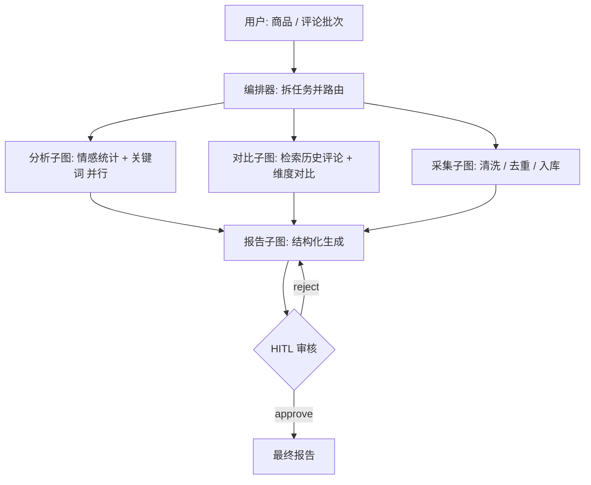

# ReviewLens

输入一批电商评论，自动跑完 清洗 → 情感分析 → 竞品维度对比 → 出洞察报告。报告必须人工点通过才输出。

## 为什么做这个

电商运营每天面对几百上千条评论，人工翻不完——通常只看最新几条，长尾里的重复投诉反而沉底，等发现时已经积累了几十条。

评论直接丢给通用大模型也不行：它会替你算数字、把一条差评说成趋势、把没提到的维度编得很像有依据。

所以做了这个：流程拆成固定几步，统计和对比由脚本算，模型只负责归纳和归因；报告在发出前必须人工审核，不让幻觉结论进周报。

## 架构

## 进度

- [x] D1 环境验证 + 仓库骨架 + 210 条评论数据（含金标注）
- [ ] D2 单 Agent 最小图 + `/chat`
- [ ] D3 RAG 子图（向量检索 + 混合召回）
- [ ] D4 三个工具 + ToolNode
- [ ] D5 编排器 + 子图并行
- [ ] D6 SQLite 检查点 + HITL 中断恢复
- [ ] D7 SSE 流式 + 单页前端
- [ ] D8 Docker 部署
- [ ] D9 评估 + 演示视频 + README 定稿

<!-- 素材区：D9 整理技术难点时从这里搬，勿删 -->

<!--
2026-11-11 通道探针（scripts/probe_llm_capabilities.py）
- sensenova deepseek-v4-flash：chat / tool_call / structured 三项全部 429
- tokenjuice DeepSeek-V4.1-Flash-1017：chat OK，tool_call 0.9s，structured 1.2s
- 结论：同一模型换通道能力不同，按 (base_url, model) 组合验证，不能按模型名判断

2026-11-11 embedding（scripts/probe_local_embedding.py）
- chromadb 默认 all-MiniLM（英文）：模型源 36 KB/s，79MB 下不完
- BAAI/bge-small-zh-v1.5 ONNX：hf-mirror 21.4 MB/s，512 维，4 条 11ms
- 语义标定：sim(物流太慢, 快递很慢)=0.792 > sim(物流太慢, 电池不耐用)=0.544 > sim(物流太慢, 音质很好)=0.415

2026-11-11 数据
- 210 条合成评论（6 个 SKU / 2 品类），30 条人为注入脏数据，金标注在 data/reviews_gold.jsonl
-->

